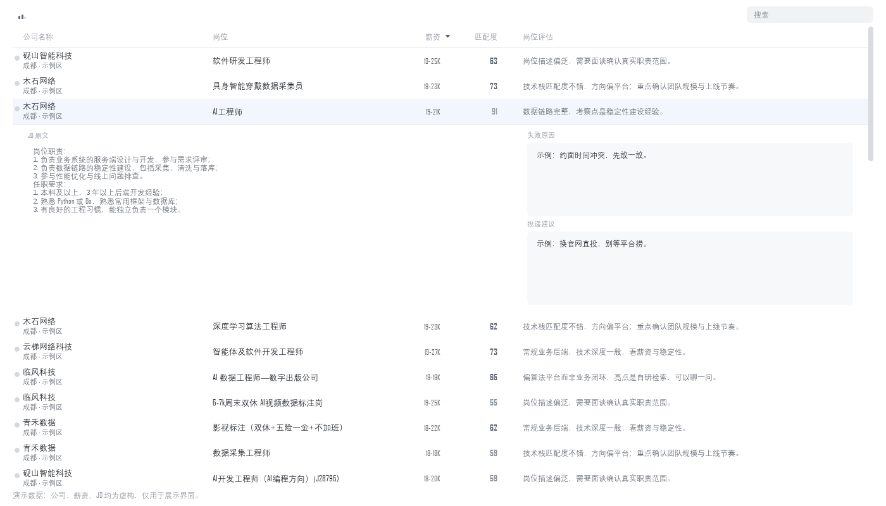
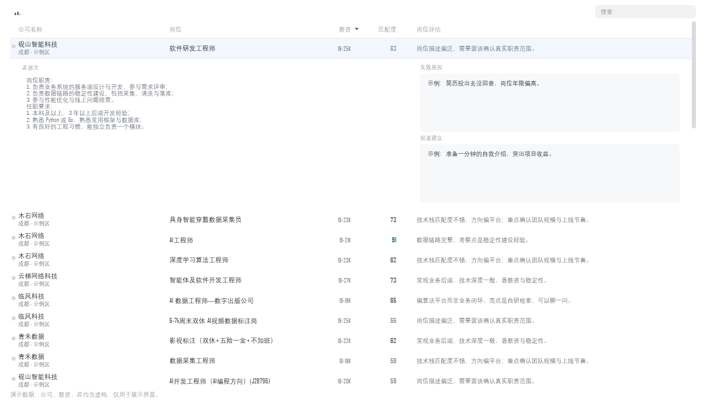

# Job Agent · 招聘信息采集与筛选台

一个跑在自己电脑上的求职辅助工具：驱动安卓模拟器采集招聘 App 的岗位列表，落到本地 SQLite，再用一个高密度表格做筛选、写评估、导出给 AI 分析。

不抓接口、不爬网页、不放在云上——就是一台机器上把「看见的岗位」变成「可以排序、可以搜索、可以记笔记、可以导出」的数据。




> 截图里的公司名、薪资、JD 全部是**合成数据**（`tools/make_preview.py` 生成），仓库里没有任何真实岗位信息。

## 为什么要做这个

求职时真正烦的不是「没岗位」，是**同一批岗位在几个 App 里反复出现，看到第 40 个就忘了前 39 个是什么**：

- 平台只给你「推荐 / 最新」，没有「我已经看过的」，更没有「我为什么跳过它」
- 想按薪资下限排序、想搜 JD 里有没有「双休」、想标记「已投 / 已拒」——都没有
- 好不容易挑出十个，想丢给 AI 帮忙分析，还得一个个复制粘贴

所以做了这个：**采集进来的岗位变成一张自己的表**，筛选、判断、记录、导出都在一个地方完成，数据是本地一个文件，随时能带走。

## 它是怎么做到「零依赖读界面」的

绝大多数 App 自动化走两条路：网页自动化（Playwright / Selenium），或截图 + OCR + 模板匹配。
这个项目走第三条：**安卓自带的控件树**。

```
adb exec-out uiautomator dump  →  一份 XML，每个控件的
                                   text / resource-id / class / bounds / clickable
```

| 对比项 | 截图 + OCR | 控件树（本项目） |
|---|---|---|
| 要不要装 OpenCV / PaddleOCR | 要 | 不要 |
| 文字准确率 | 受字体、缩放、抗锯齿影响 | 100%，就是 App 里的原文 |
| 单个页面耗时 | 0.2–2 秒 | 约 1.3 秒 |
| 定位方式 | 靠猜坐标 | `bounds` 精确到像素 |
| 依赖 | 一堆 | 只要 adb + Python 标准库 |

代价是它**只对原生 App 有效**——H5 页面、游戏画面、Flutter 自绘界面读不到。招聘 App 恰好是原生安卓。

唯一要看像素的地方是「这个岗位我是不是点开过」：App 把看过的标题显示成灰色，而颜色**不在控件树里**，只能取一帧原始像素、量标题笔画的最暗亮度（黑字 ≈34、灰字 ≈153，阈值 110 干净分开）。一屏截一次图约 0.8 秒，换来每个看过的岗位省掉一次 12 秒的进出详情页。

## 它能做什么

**采集**
- `adb` + `uiautomator` 驱动安卓模拟器或真机，按 App 的界面走，不依赖任何私有接口
- 多个 Tab 轮换、随机等待、单次/单日配额、超时保护，避免机械式高频访问
- 按列表条目颜色判断「已读」，已看过的自动跳过，不重复入库
- 中断可续：异常退出后重跑会接着上一批

**存储与筛选**
- SQLite 单文件，`company` / `job` / `job_source` / `job_revision` 规范化建模；同一岗位多个来源记在子表，不丢信息
- 公司名归一化 + 别名表，把「XX科技（成都）有限公司」和「XX科技」合并成一家
- 状态机：待评估 → 建议投 / 谨慎投 → 面试中 → 已淘汰 / 已拒绝；JD 过短的自动进「已排除」，不参与筛选但保留可查
- 全文检索：FTS5 `trigram` 分词，两字以内的短词自动回退 `LIKE`——中文搜索的坑在这
- 结构变更走 `schema_version` + 迁移脚本，老库能原地升级

**界面（PySide6）**
- 高密度表格：公司（含城市）、岗位、薪资、匹配度、岗位评估，一屏二十多行
- 点一行原地展开：左边 JD 原文，右边「岗位评估 / 失败原因 / 投递建议」三个框，失焦自动保存
- 行内直接改、拖拽列顺序、点表头排序、按状态与关键词筛选
- 版本号乐观锁：别处改过的行不会被旧数据覆盖

**导出**
- 每次采集结束自动导出（可在设置里关）
- `日期-岗位采集.xlsx`：丢进 Excel 排
- `日期-岗位采集.md`：一个岗位一段，直接贴给任何 AI，不用再解释表结构

## 快速开始

需要 Windows（模拟器在 Windows 上跑）、Python 3.12+、一个安卓模拟器或真机。

```bash
git clone https://github.com/Wooden-Ghost/job-agent.git
cd job-agent
python -m pip install -r requirements.txt

copy config.example.json config.json   # 需要的话改默认城市、配额
python launch.py                       # 或者双击 JobAgent.cmd
```

第一次用先点「环境配置」自检 `adb` 与设备；`python -m job_agent check` 可以在命令行做同样的事。

采集参数都在「采集设置」页：每 Tab 翻几屏、单次上限、单日上限、随机等待区间、是否跑完自动导出。

## 架构

```
安卓模拟器 ──adb/uiautomator──▶ harvest.py   读列表、点进详情、抓 JD
                                    │
                                    ▼
                               flow.py       编排：配额、限速、去重、断点
                                    │
                                    ▼
                               store.py      SQLite：幂等写入 + 迁移 + 检索
                                    │
                     ┌──────────────┼──────────────┐
                     ▼              ▼              ▼
                 ui/ 数据库窗口   exports/*.md   exports/*.xlsx
```

```
job_agent/
  flow.py       采集编排（配额/限速/续采）
  harvest.py    界面动作与 JD 抓取
  detect.py     环境探测（设备、模拟器、adb）
  store.py      数据层：schema 版本、检索、导出 md
  enrich.py     页面元信息补全
  naming.py     公司名/岗位名归一、指纹
  ui/           PySide6 界面（主题、页面、数据库窗口）
db/
  schema.sql            结构的唯一真相
  migrations/000N_*.sql 增量迁移，幂等
etl/                    外部表格导入
tests/                  unittest + 合成数据 fixture
tools/                  开发期脚本（原型、打包、截图）
```

数据模型上几个刻意的选择：

- **岗位与来源分开**：同一个岗位可能在多个平台出现，`job_source` 存来源、URL、关键词，`job` 只存岗位本身
- **JD 有历史**：`job_revision` 记 JD 指纹与长度，JD 改过能看出来
- **人工判断与机器结论分开**：`screening` 存结论，`job.analysis / fail_reason / advice` 存自己写的文字，AI 重新分析不会覆盖你的笔记
- **软删除 + 唯一索引**：唯一约束都带 `WHERE deleted_at IS NULL`，删了之后同一个岗位还能重新进来

## 一些实现上的坑（写在这里，省得你踩）

| 问题 | 做法 |
|---|---|
| 中文全文检索 | `trigram` 只对 3 字以上有效，`算法`、`国企` 这种两字词查不到 → 两字以内回退 `LIKE` 全表扫（5 万行以内够用） |
| FTS 表的主键 | 岗位是 TEXT 主键、没有 `rowid` 可挂 → 用 standalone FTS5，不依赖 `content_rowid` |
| 时间 | 采集端拿到的是本地无时区字符串，入库统一转 UTC ISO8601，另存 `biz_date` 保留「哪天采的」 |
| 重复采集 | `ON CONFLICT DO UPDATE` + 岗位指纹，重跑幂等；导入器可以先 `--dry-run` 只看计划不动库 |
| 测试要真实数据 | 不行。`tests/fixtures/build_fixture.py` 用合成数据造同构库，测试永远不碰 `data/jobs.db` |
| 中文表格排版 | PySide6 里自己算省略宽、自己画状态点；列宽按视口裁剪，否则最后一列永远被切 |

## 数据与隐私

- 只采集**你自己账号能看到**的公开列表页，不登录、不绕风控、不碰私有接口
- 数据只落本机一个 SQLite 文件，不出网（除了 App 自己的请求）
- 仓库里没有任何真实数据：`.gitignore` 挡住 `data/ exports/ logs/ config.json docs/shots/` 和所有 `.db` / `.xlsx`；截图用合成数据生成
- 采集频率默认保守（每翻 6 屏停顿、随机 1–4 秒、单日上限 120 条），但**账号风险由使用者自己承担**

## 现状与计划

- 采集、存储、导出、数据库窗口都已可用；界面正在往更紧凑的表格布局重构，`tools/demo_table.py` 是可运行的原型（就是上面截图那个）
- 下一步：受控 Excel 往返（导出改完再导回，只允许改指定列）、旧表冻结、采集端迁移到新表

## 许可

MIT，见 [LICENSE](LICENSE)。
